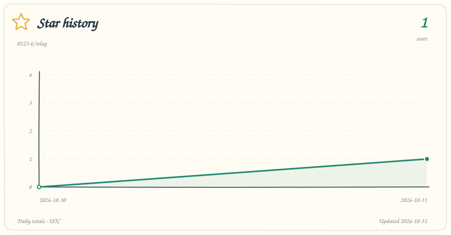

<p align="center">
  
</p>

# Relay

[English](README.md) · [简体中文](README.zh-CN.md)

## Persistent Memory for AI Agents

**Agents can be replaced. Your memory stays with you.**

Mostly stateless agents. Persistent memory, managed by agents.

Describe your goals, provide the necessary context, and decide what the agent may do. The agent carries out the work and maintains your background, tasks, decisions, and progress so the next session can pick up where you left off. The agent organizes and updates human-data; you do not have to maintain it manually.

Shared behavior is defined in a single [relay.md](relay.md). Tool-specific entry files load it; human-data holds the accumulated working memory. The project needs no service or package installation and does not require a particular model. Local version history uses Git, which the agent checks before use.

## A mostly stateless agent

Relay treats the agent as a mostly stateless, replaceable executor. human-data is the single authoritative home for persistent working memory and task state, carrying almost all work-related memory. The current conversation is a temporary working context, and a tool's private memory can assist. Work continuity should come from the external records.

The agent continuously records information, decisions and their basis, progress, and unfinished work as it works. It can search, reread, and organize the authorized memory whenever needed; you do not have to maintain it or approve each routine lookup. Keeping something in the current chat is not a reason to leave it unwritten.

The intended handover is that a new agent, without the old chat history, can recover the goal, constraints, work state, and next step from the shared core, human-data, and the referenced material it has permission to access. The agent chooses how to organize and retrieve that information. This does not require saving every token or transient step; it is a working discipline, not a guarantee of complete lossless recovery.

## Getting started

1. Download this project and keep it somewhere you intend to store your working context over time.
2. Open the directory with an agent that can read and write local files and execute tasks. Trust the workspace and enable project instructions as required by your tool.
3. Describe your task. The agent initializes human-data as needed and maintains it afterward.

For a first session, you can say:

```text
Read relay.md in this directory, then restore or initialize human-data.
Follow those instructions to carry out my task and maintain working memory as you go.
My task is: …
```

Supported tools discover the core through their own entry files. This prompt also helps verify a first connection or connect another agent with file tools. There is no background questionnaire to fill out.

Initially, human-data contains only a `.gitkeep` placeholder. The agent creates folders, records, and summaries as needed. The project ships with no personal information or sample tasks.

## Everyday use

Give the agent tasks, requirements, and feedback as you normally would. It should keep its working memory and task state in human-data throughout the work, including goals, confirmations, decisions and their basis, progress, verification results, and unfinished work.

When you switch sessions or agents, have the new agent read the same core and working memory. You only need to supply missing information when it affects correctness, scope, or authorization.

The following is an intended workflow example, not a completed performance test:

1. You provide a project's location and ask the agent to fix an issue.
2. The agent reads that project's instructions, investigates, makes the change, verifies it, and records the results and remaining work.
3. In a new session, you say, “Continue the previous task.”
4. The new agent finds the project location, current status, and next step in human-data, checks the current code, and continues.

## Versioning working memory

The core authorizes routine local Git operations within the hub, including initialization, status and diff checks, history inspection, staging, and commits. The agent does not need to ask before each operation. Git permissions for other projects still follow their own agreements. Remote configuration, pushing, publishing, rewriting history, and discarding changes require the appropriate authorization.

When you first use the hub for real work, the agent creates an independent local Git repository inside human-data. It records meaningful changes after initial setup, important decisions, task milestones, organization, and handover. You do not have to initialize it or commit memory manually. Maintaining or reviewing the public template leaves its memory placeholder empty.

The two repositories serve separate purposes:

- The project repository stores shared instructions, entry files, documentation, and the icon. Its ignore rules continue to exclude private memory.
- The independent human-data repository stores memory history. It starts with no remote; it is not added to the project as a submodule. Its own ignore rules exclude credentials and temporary files.

The agent checks that the memory repository's actual root is human-data. Discovering the parent repository is not sufficient. Memory commands explicitly use `git -C <absolute path to human-data>` so commits go to the intended repository.

Existing memory repositories retain their history, branch, and configuration. Unrelated pending or staged work is left intact. If Git, a configured identity, or permissions are missing, the agent keeps the written records and reports that versioning is not yet complete. No empty commits are needed when nothing changed.

History supports traceability; the agent still maintains a concise current index, summaries, and useful archives. Native automatic commits in a tool apply only to the repository it manages; the agent must also verify that memory changes were committed in the independent repository.

## Working across projects

One hub can serve several independent projects. Source code stays in each project's directory; background, decisions, and handover information stay in this hub's human-data.

If you start the agent elsewhere, provide the hub's actual path and grant the permissions it needs to read the core, read and write human-data, and work on the target project:

```text
My personal work hub is at <the actual absolute path to this hub>.
Read its relay.md and human-data to restore the task context first.
The project for this task is at <the actual absolute path to the target project>.
```

Entry files apply within the workspace or directory scope defined by each tool. Downloading this project does not change global tool settings or make agents in other projects discover the hub automatically.

## File responsibilities

| File or directory | Purpose |
| --- | --- |
| [relay.md](relay.md) | The single shared set of agent instructions |
| README.md / [README.zh-CN.md](README.zh-CN.md) | Human-facing introduction, setup, and compatibility notes |
| human-data/ | Agent-managed working memory; an independent local Git repository is created on first real use |
| AGENTS.md, CLAUDE.md, GEMINI.md, etc. | Load the core according to each tool's conventions |
| opencode.json, .aider.conf.yml | Load the core through native tool configuration |
| [assets/logo.svg](assets/logo.svg) | Project icon: connected work nodes around a shared memory document |
| [Star workflow](.github/workflows/star-history.yml) / [collector](scripts/update-star-history.py) | Automatically collect daily GitHub star totals and render the charts |
| [Star records](data/star-history.json) / assets/star-history*.svg | Public daily samples and matching light/dark chart assets |
| .gitignore | Excludes working memory, local credential files, and temporary files by default |

## Tool compatibility

The table is based on official documentation reviewed on 2026-10-30. Entry files, relative paths, and configuration syntax have been checked statically. Automatic loading, task execution, and memory write-back have not been tested in fresh sessions with every tool. “Import” means native inclusion; a “read instruction” asks the agent to use a file-reading tool. These are different mechanisms.

| Tool | Entry provided | Loading behavior and limitations | Official reference |
| --- | --- | --- | --- |
| OpenAI Codex | `AGENTS.md` | A read instruction loads the core after entry discovery; instruction scope and actual permissions apply | [OpenAI Docs](https://learn.chatgpt.com/docs/agent-configuration/agents-md) |
| Claude Code | `CLAUDE.md` | Native `@./relay.md` import; does not rely on AGENTS version or fallback behavior | [Memory](https://code.claude.com/docs/en/memory) |
| Gemini CLI | `GEMINI.md` | Native `@./relay.md` import | [Context files](https://geminicli.com/docs/cli/gemini-md/) |
| Qwen Code | `QWEN.md` | `@./relay.md` reference; newer versions may also load AGENTS | [Memory](https://qwenlm.github.io/qwen-code-docs/en/users/features/memory/) |
| GitHub Copilot | `.github/copilot-instructions.md`, `AGENTS.md` | A read instruction loads the core; instruction support and file access vary across clients, agents, and code review | [Custom instructions](https://docs.github.com/en/copilot/concepts/prompting-and-context/custom-instructions) |
| Cursor | `AGENTS.md` | Project instructions direct the agent to read the core | [Rules](https://cursor.com/docs/rules) |
| Cline | `AGENTS.md`, `.clinerules/relay.md` | Standard entry and native rule; confirm they are enabled in the Rules panel; duplicate entries should not repeat initialization | [Cline Rules](https://github.com/cline/cline/blob/main/docs/customization/cline-rules.mdx) |
| Roo Code | `.roo/rules/relay.md` | Native workspace rule; AGENTS support depends on settings | [Custom instructions](https://github.com/RooCodeInc/Roo-Code/blob/main/apps/docs/docs/features/custom-instructions.md) |
| Continue | `.continue/rules/relay.md` | `alwaysApply: true`; requires an agent mode with file access; autocomplete does not include these rules | [Rules](https://docs.continue.dev/customize/deep-dives/rules) |
| TRAE | `.trae/rules/project_rules.md` | Provides a project rule with alwaysApply; the full official rules page could not be retrieved, so the filename follows the official article; current directory and activation behavior still need testing | [Rules](https://docs.trae.ai/ide/rules), [Official article](https://www.trae.ai/blog/trae_tutorial_0825) |
| OpenCode | `opencode.json`, `AGENTS.md` | Native `instructions` loading, with AGENTS as a shared entry | [Rules](https://opencode.ai/docs/rules/) |
| Aider | `.aider.conf.yml` | Native `read` loading; local automatic commits are enabled; the agent versions the independent memory repository according to the core | [YAML config](https://aider.chat/docs/config/aider_conf.html) |
| Kiro | `AGENTS.md` | Standard entry; custom agents may require explicit resources configuration | [Steering](https://kiro.dev/docs/steering/) |
| JetBrains Junie | `AGENTS.md`, `.junie/guidelines.md` | Standard entry with a legacy guidelines fallback; a custom Guidelines path can change discovery | [Guidelines](https://junie.jetbrains.com/docs/guidelines-and-memory.html) |
| Google Antigravity | `AGENTS.md`, `GEMINI.md` | Uses supported workspace entries; confirm the loading source for the specific product surface | [Rules](https://antigravity.google/docs/rules/) |
| Qoder IDE | `AGENTS.md` | Officially recognized automatically; existing native rules may override conflicting instructions | [Rules](https://docs.qoder.com/user-guide/rules) |
| Zed built-in agent | `AGENTS.md` | Project instructions; external agents running inside Zed follow their own loading rules | [Instructions](https://zed.dev/docs/ai/instructions) |
| Warp | `AGENTS.md` | Project rules; confirm the relevant context feature is enabled | [Project rules](https://docs.warp.dev/knowledge-and-collaboration/warp-drive/ai-objects/) |
| goose | `.goosehints` | Native `@relay.md` inclusion; requires the Developer extension | [Hints](https://goose-docs.ai/docs/guides/context-engineering/using-goosehints/) |
| Factory Droid | `AGENTS.md` | Persistent project instructions direct the agent to read the core | [AGENTS.md](https://docs.factory.com/harness/agents-md) |

The [official AGENTS.md ecosystem list](https://agents.md/) also includes Jules and Devin. Windsurf's former official entry page redirected to Devin documentation that could not be retrieved, so no unverified new paths have been added. These tools currently receive the shared AGENTS.md entry; version-specific behavior, loading precedence, and memory write-back still need verification. Ecosystem listing alone is not a completed compatibility check.

This project is intended for agents with file read/write tools. Browser-only chat, inline completion, and review features that cannot read other files need an additional integration. Compatibility is recorded by tool and feature; no unmeasured coverage percentage is promised.

## Verifying a connection

When using a tool for the first time:

1. Ask the agent to identify the actual core file path and human-data location, and check that it read the file.
2. Give it a non-sensitive task or preference, let it save the information according to the core instructions, and inspect the actual files.
3. Open a fresh session without inherited chat context and ask it to recover that information from working memory.

Completing these steps confirms reading and write-back for that tool in your environment. Trust settings, directory permissions, ignore rules, modes, and versions can affect the result.

## Personal data and the public template

The project-level `.gitignore` excludes actual content in human-data, including its independent Git metadata, and retains only `.gitkeep`. Memory history stays in the independent local repository. Ignore rules do not encrypt files or remove previously committed history. Before publishing, check that the project repository contains only the template files you intend to share.

Personal background, company information, and task records created during use belong in your private working copy. The agent still needs permission to read those ignored files. If a tool also blocks file access based on ignore rules, allow this directory in that tool separately.

## Scope

Results depend on the agent's capabilities, task scope, available context, and authorization. This project provides shared working instructions and portable memory. Background services, scheduling, and concurrency locks are left to the tools you use.

Update relay.md to change shared behavior. Let the agent maintain preferences, project progress, and specific tasks in human-data. Update entry files when loading conventions change, keeping one shared core.

## Star history

<picture>
  <source media="(prefers-color-scheme: dark)" srcset="assets/star-history-dark.svg">
  
</picture>

After publishing this project to GitHub, enable Actions and allow the **Star history** workflow to write to the default branch. It discovers the current repository automatically and uses GitHub's built-in token; no personal token, external service, or additional Python packages are needed.

- The first push containing the workflow starts collection. Afterward it runs daily at **02:23 UTC** and can also be started from **Actions → Star history → Run workflow**.
- Actual star totals are stored in [data/star-history.json](data/star-history.json). Rerunning on the same UTC day updates that day's sample. Totals can decrease when people unstar the project; missing days are not filled with invented values.
- History starts when collection is enabled. A single sample appears as a point; a line appears after samples from multiple dates. The initial chart is an empty state with no fabricated growth.
- GitHub schedules can be delayed, and public scheduled workflows may be disabled after 60 days without repository activity; see [GitHub's scheduling rules](https://docs.github.com/en/actions/reference/workflows-and-actions/events-that-trigger-workflows#schedule). Branch rules must permit the workflow's commits.

Only the public Star data and its two SVGs are committed by this workflow. Its schedule handles project statistics; it does not schedule your personal work or access human-data.
